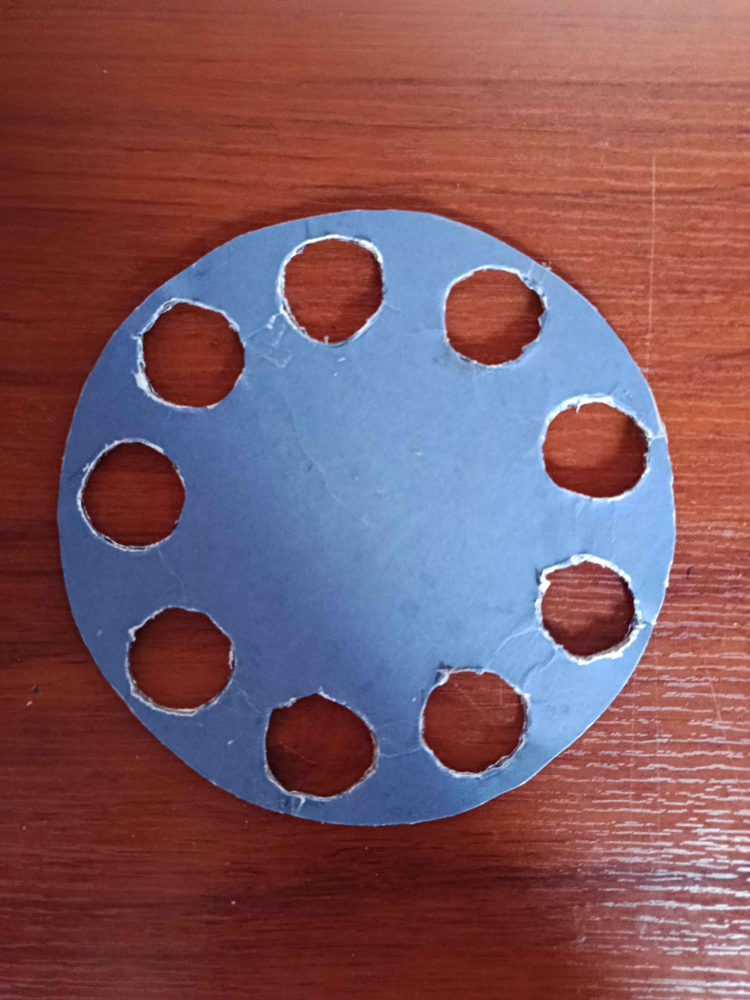

<strong>Integrantes:</strong>

<ul>
    <li>Jeicob David Pinilla Ruiz</li>
    <li>Fabian Abril Casallas</li>
</ul>

    <h1 align="center"><b>Segundo entrega</b></h1>

<h2><b>1. Banda Transportadora</b></h2>

Para esta segunda entrega ya se construyo la banda trasportadora en carton piedra y para su funcionamiento se utiliza
un motorreductor tal y como se muestra acontinuacion.

    

Dado que el material utilizado para la base es cartón fue necesario ponerle peso para evitar que 
se mueva por el movimiento y la fuerza del motor ya que no es un material rígido como el plastico
o la madera.

    <a href="https://youtu.be/Q1X_BEJc92w" target="_blank">
        <b>Video de funcionamiento</b>
    </a>

<h2><b>Disco Selector de Vasos</b></h2>

Para el disco selector de vasos de construyo en cartón piedra tal y como se muestra
aconstinuacion.

    

Al colocar los vasos y comprobar la caida de las monedas se evidencio que el vaso se desplaza
por lo cual será necesario usar imanes para la sujeción de los vasos ya que cuando no ahí monedas 
o el peso de estas no es el suficiente el vaso se cae.

    

