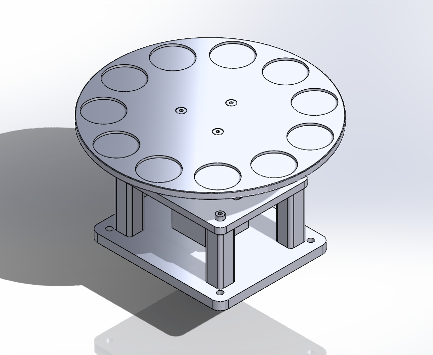
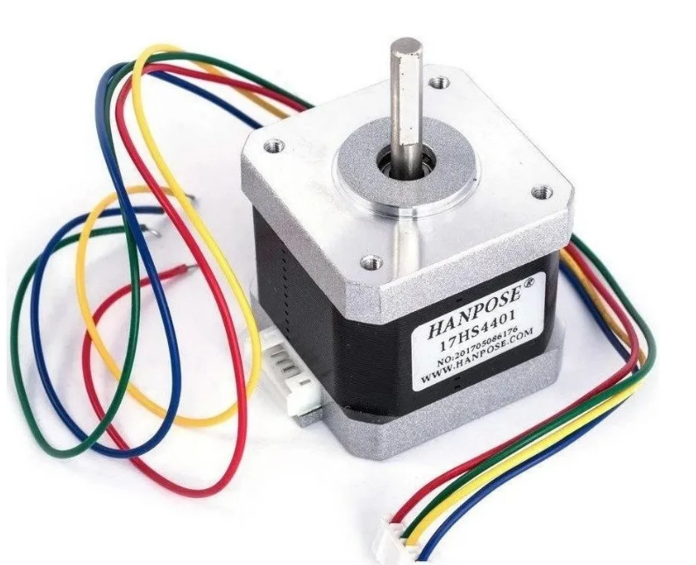
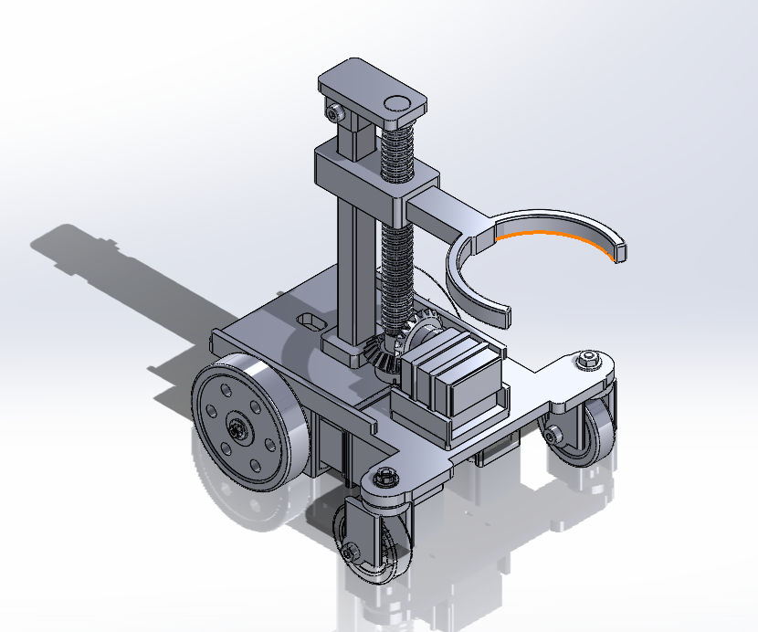
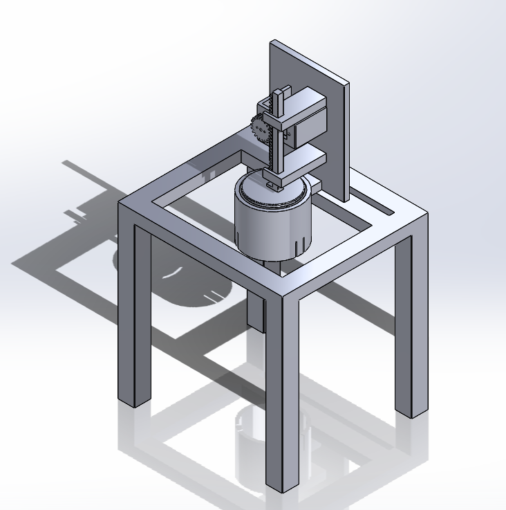
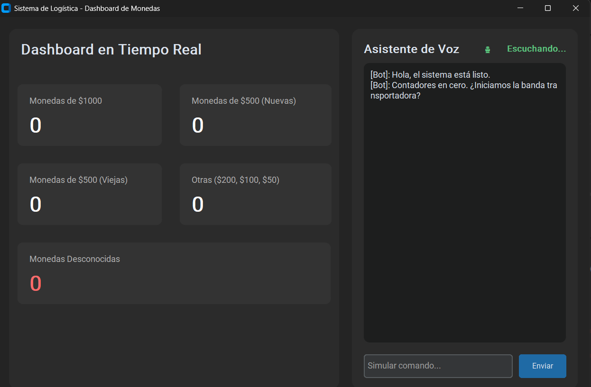

<strong>Integrantes:</strong>

<ul>
    <li>Jeicob David Pinilla Ruiz</li>
    <li>Fabian Abril Casallas</li>
</ul>

    <h1 align="center"><b>Segundo entrega</b></h1>

<h2><b>1. Banda Transportadora</b></h2>

Para esta segunda entrega ya se construyo la banda trasportadora en carton piedra y para su funcionamiento se utiliza
un motorreductor tal y como se muestra acontinuacion.

    

Dado que el material utilizado para la base es cartón fue necesario ponerle peso para evitar que 
se mueva por el movimiento y la fuerza del motor ya que no es un material rígido como el plastico
o la madera.

    <a href="https://youtu.be/Q1X_BEJc92w" target="_blank">
        <b>Video de funcionamiento</b>
    </a>

<h2><b>2. Disco Selector de Vasos</b></h2>

Una vez clasificada la moneda, esta cae dentro de uno de los recipientes
colocados en el disco selector. El disco cuenta con 10 espacios diseñados
para alojar los vasos donde se almacenarán las monedas según su denominación.

Para garantizar el alineamiento exacto debajo del punto de caída de la moneda,
el disco es impulsado por un motor paso a paso NEMA 17. La ESP32 calcula con
precisión el ángulo de giro necesario para ubicar el vaso correspondiente
en la posición correcta.

    

    

<h2><b>3. Carro de Transporte con Garra Robótica </b></h2>

Cuando un vaso alcanza la cantidad requerida de monedas, entra en acción el
sistema de transporte. Este consiste en un carro móvil equipado con una garra
de sujeción accionada por un servomotor MG90S.

El giro del servomotor permite abrir y cerrar la garra de manera firme sobre
el vaso lleno, permitiendo retirarlo de la estación de selección y desplazarlo
hacia el área de sellado.

    

<h2><b>4. Sistema de Tapado Mecánico </b></h2>

El proceso de empaquetado finaliza en el módulo de tapado. Este sistema cuenta
con un servomotor conectado a un mecanismo de transmisión tipo piñón-cremallera.
Al activarse el servo, la cremallera se desplaza linealmente empujando la tapa
sobre la parte superior del vaso hasta sellarlo.

    

<h2><b>5. Interfaz de Monitoreo y Chatbot en Python </b></h2>

El sistema cuenta con una interfaz gráfica desarrollada en Python que se
comunica en tiempo real con el proceso. En el panel principal se muestra
el desglose del conteo continuo de las monedas procesadas por denominación,
incluyendo monedas de $1000, monedas de $500 nuevas, monedas de $500 antiguas,
otras denominaciones y monedas no reconocidas.

Adicionalmente, la interfaz integra un asistente de voz y un chatbot en tiempo
real que brinda comentarios sobre el estado del proyecto, notifica cuando los
contadores están listos e informa cuando se requiere iniciar la marcha de la
banda transportadora.

   

