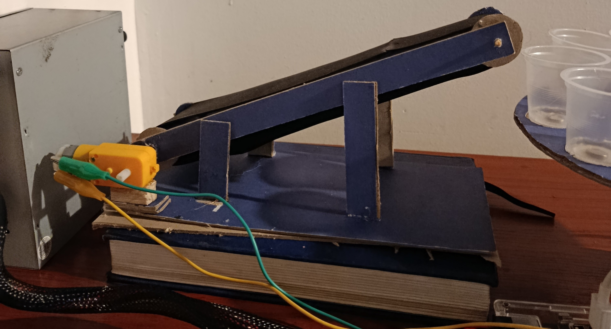
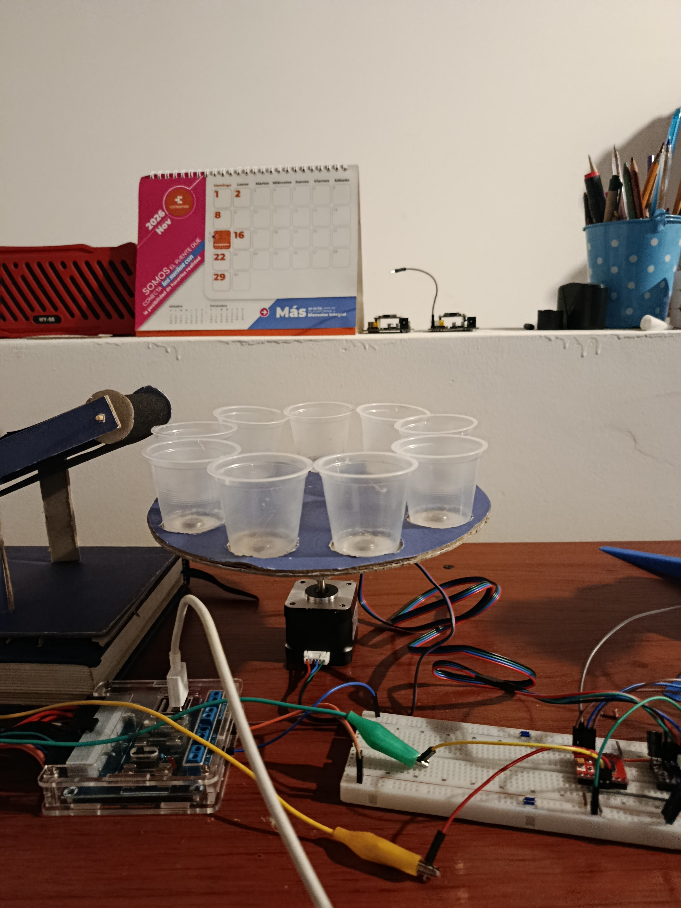

<strong>Integrantes:</strong>

<ul>
    <li>Jeicob David Pinilla Ruiz</li>
    <li>Fabian Abril Casallas</li>
</ul>

    <h1 align="center"><b>Tercera entrega</b></h1>

<h2><b>1. Banda Transportadora</b></h2>

    

Para esta segunda entrega ya se implemento el control de la banda transportadora 
por medio de un modulo TB6612FNG que permite controlar encendido, apagado, dirección y velocidad 
del motoreductor usado para el mobvimiento de la banda trasnportadora.

    

El controlador se conecto a una fuente de 5V DC.

<h2><b>2. Disco Selector de Vasos</b></h2>

    

Para el movimiento del disco selector de vasos se utlizo un motor NEMA 17 controlado por medio de
un driver DRV8825 que permite no solo suministrar la potencia necesaria para controlar el motor y adema aumentar la resolución del ángulo por medio de los pasos logrando hasta 1/32 de paso lo que equivale a una precisión de 0.05625°.

    

El Driver se alimento a 12 V DC y se uso una resolucion de 1/16 de paso que r}equivale a 0.1125° lo cual es una presicion muy buena para esta aplicacion ya que los saltos son de 40°.

<h2><b>3. Brazo Robotico</b></h2>

    

Para mover y tapar los vasos se utiliza un brazo robótico el cual se diseño en solid works 
y se imprimio en 3D en PLA y para las pinzas se utilizo TPU.

    

Para el movimiento y control del brazo robotica se utlizan servos MG996R de 180° ya que cuentan con 
una fuerza mayor a los servos pequeños y además al ser de 180° tienen un tope que permite por medio
de PWM controlar el angulo de manera precisa.

Originalmente el brazo se diseñó con 5 grados de libertad, sin embargo 2 servos se dañaron por lo cual se retiró un eslabón dejando 3 grados de libertad. Por lo cual ahora solo se puede girar la base, subir y bajar el eslabón del brazo, así como abrir y cerrar la garra para sujetar o soltar los vasos.

<h2><b>4. Interfaz</b></h2>

    

Por ahora se cuenta con una interfaz que permite controlar todo de manera manual
esto con el fin de verificar el funcionamiento de todo el sistema para luego inplementar 
un sistema autónomo que utilice el modelo de yole para la detección de las monedas y el control
del sistema además del chat-bot y visualizar en tiempo real el conteo de las monedas.

    <a href="https://youtu.be/Bdja7fUhHcs" target="_blank">
        <b>Video de funcionamiento</b>
    </a>

