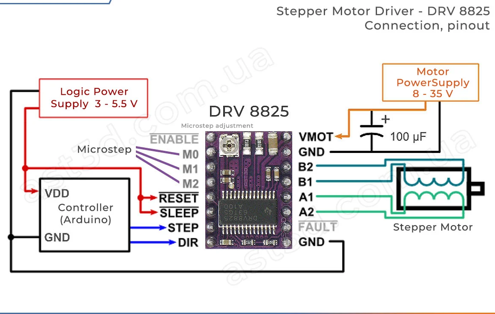
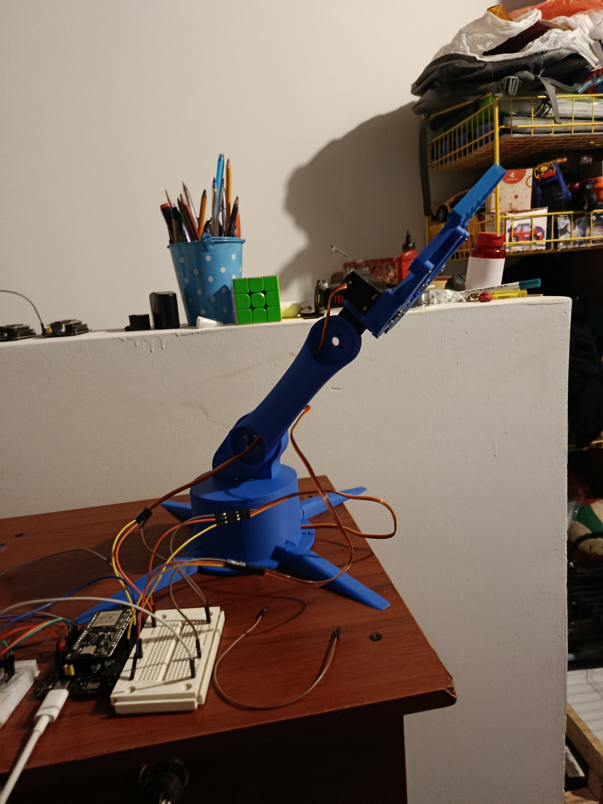
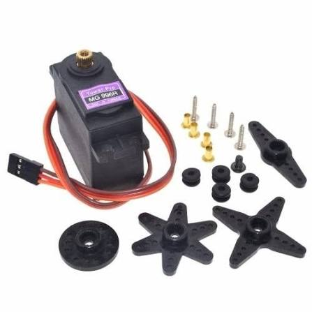
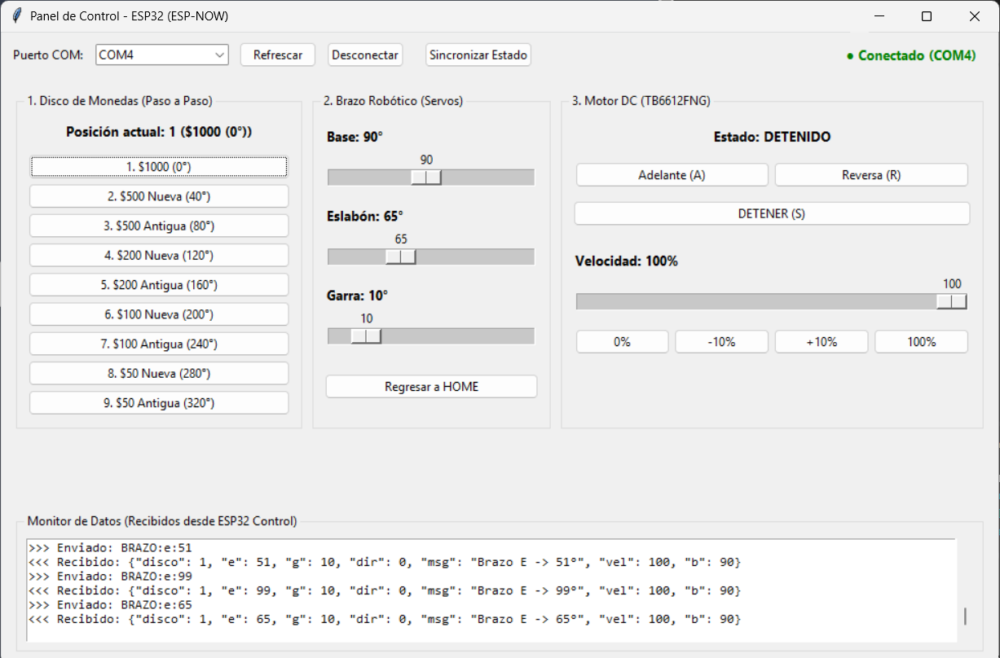

<strong>Integrantes:</strong>

<ul>
    <li>Jeicob David Pinilla Ruiz</li>
    <li>Fabian Abril Casallas</li>
</ul>

    <h1 align="center"><b>Tercera entrega</b></h1>

<h2><b>1. Banda Transportadora</b></h2>

    

Para esta segunda entrega ya se implemento el control de la banda transportadora 
por medio de un modulo TB6612FNG que permite controlar encendido, apagado, dirección y velocidad 
del motoreductor usado para el mobvimiento de la banda trasnportadora.

    

El controlador se conecto a una fuente de 5V DC.

<h2><b>2. Disco Selector de Vasos</b></h2>

    

Para el movimiento del disco selector de vasos se utlizo un motor NEMA 17 controlado por medio de
un driver DRV8825 que permite no solo suministrar la potencia necesaria para controlar el motor y adema aumentar la resolución del ángulo por medio de los pasos logrando hasta 1/32 de paso lo que equivale a una precisión de 0.05625°.

    

El Driver se alimento a 12 V DC y se uso una resolucion de 1/16 de paso que r}equivale a 0.1125° lo cual es una presicion muy buena para esta aplicacion ya que los saltos son de 40°.

<h2><b>3. Brazo Robotico</b></h2>

    

Para mover y tapar los vasos se utiliza un brazo robótico el cual se diseño en solid works 
y se imprimio en 3D en PLA y para las pinzas se utilizo TPU.

    

Para el movimiento y control del brazo robotica se utlizan servos MG996R de 180° ya que cuentan con 
una fuerza mayor a los servos pequeños y además al ser de 180° tienen un tope que permite por medio
de PWM controlar el angulo de manera precisa.

Originalmente el brazo se diseñó con 5 grados de libertad, sin embargo 2 servos se dañaron por lo cual se retiró un eslabón dejando 3 grados de libertad. Por lo cual ahora solo se puede girar la base, subir y bajar el eslabón del brazo, así como abrir y cerrar la garra para sujetar o soltar los vasos.

<h2><b>4. Interfaz</b></h2>

    

Por ahora se cuenta con una interfaz que permite controlar todo de manera manual
esto con el fin de verificar el funcionamiento de todo el sistema para luego inplementar 
un sistema autónomo que utilice el modelo de yole para la detección de las monedas y el control
del sistema además del chat-bot y visualizar en tiempo real el conteo de las monedas.

<h2><b>1. Código ESP-32 de control</b></h2>

Este programa se encarga de controlar la banda trasportadora, el disco de clasificacion y el 
brazo robotico.

<pre>
<code>

from machine import Pin, PWM
import network
import espnow
import time
import json

# ==========================================
# CONFIGURACIÓN ESP-NOW
# ==========================================
PEER_PC = b'\x68\xee\x8f\x4d\xcf\xac'  MAC de la ESP32 conectada al PC

sta = network.WLAN(network.STA_IF)
sta.active(True)
sta.disconnect()

en = espnow.ESPNow()
en.active(True)
en.add_peer(PEER_PC)

# ==========================================
# 1. MOTOR PASO A PASO (DISCO)
# ==========================================
dir_pin = Pin(26, Pin.OUT)
step_pin = Pin(27, Pin.OUT)

pasos_por_vuelta = 3200
retardo_inicio = 1200
retardo_minimo = 350

posiciones = {
    1: ("$1000", 0),
    2: ("$500 Nueva", 40),
    3: ("$500 Antigua", 80),
    4: ("$200 Nueva", 120),
    5: ("$200 Antigua", 160),
    6: ("$100 Nueva", 200),
    7: ("$100 Antigua", 240),
    8: ("$50 Nueva", 280),
    9: ("$50 Antigua", 320)
}

pasos_actuales = 0
pos_disco_actual = 1

def mover_pasos(pasos):
    if pasos == 0:
        return
    if pasos > 0:
        dir_pin.value(1)
    else:
        dir_pin.value(0)
        pasos = abs(pasos)

    retardo_actual = retardo_inicio
    pasos_aceleracion = int(pasos * 0.25)

    for i in range(pasos):
        if i < pasos_aceleracion and retardo_actual > retardo_minimo:
            retardo_actual -= 4
        elif i > (pasos - pasos_aceleracion) and retardo_actual < retardo_inicio:
            retardo_actual += 4

        step_pin.value(1)
        time.sleep_us(retardo_actual)
        step_pin.value(0)
        time.sleep_us(retardo_actual)

def ir_a_posicion(num_pos):
    global pasos_actuales, pos_disco_actual
    nombre, grados_objetivo = posiciones[num_pos]
    pasos_objetivo = round((grados_objetivo * pasos_por_vuelta) / 360.0)
    diferencia = pasos_objetivo - pasos_actuales

    if diferencia > pasos_por_vuelta // 2:
        diferencia -= pasos_por_vuelta
    elif diferencia < -(pasos_por_vuelta // 2):
        diferencia += pasos_por_vuelta

    mover_pasos(diferencia)
    pasos_actuales = pasos_objetivo
    pos_disco_actual = num_pos
    return f"Disco en pos {num_pos} ({nombre})"

# ==========================================
# 2. BRAZO ROBÓTICO (SERVOS)
# ==========================================
PIN_BASE    = 19
PIN_ESLABON = 15
PIN_GARRA   = 18

VEL_BASE_MS    = 0
VEL_ESLABON_MS = 30
VEL_GARRA_MS   = 0

HOME_BASE    = 90
HOME_ESLABON = 90
HOME_GARRA   = 10

ARCHIVO_ESTADO = "estado.json"
LIMITES = {"b": (10, 180), "e": (10, 180), "g": (0, 80)}

def angulo_a_duty(angulo):
    return int(1638 + (angulo / 180) * (8192 - 1638))

def mover_servo(servo, angulo):
    servo.duty_u16(angulo_a_duty(angulo))

def mover_suave(servo, ang_actual, ang_objetivo, pausa_ms):
    if ang_actual == ang_objetivo:
        return ang_objetivo
    if pausa_ms <= 0:
        mover_servo(servo, ang_objetivo)
        return ang_objetivo

    paso = 1 if ang_objetivo > ang_actual else -1
    for ang in range(ang_actual, ang_objetivo + paso, paso):
        mover_servo(servo, ang)
        time.sleep_ms(pausa_ms)
    return ang_objetivo

def guardar_estado(b, e, g):
    with open(ARCHIVO_ESTADO, "w") as f:
        json.dump({"b": b, "e": e, "g": g}, f)

def cargar_estado():
    try:
        with open(ARCHIVO_ESTADO, "r") as f:
            d = json.load(f)
            return d["b"], d["e"], d["g"]
    except (OSError, ValueError, KeyError):
        return HOME_BASE, HOME_ESLABON, HOME_GARRA

# ==========================================
# 3. MOTOR DC (TB6612FNG)
# ==========================================
PWMA = PWM(Pin(25), freq=20000)
AIN1 = Pin(32, Pin.OUT)
AIN2 = Pin(23, Pin.OUT)
STBY = Pin(33, Pin.OUT)

velocidad = 50
sentido = 0
STBY.value(1)

def actualizar_motor_dc():
    if sentido == 1:
        AIN1.value(1)
        AIN2.value(0)
    elif sentido == -1:
        AIN1.value(0)
        AIN2.value(1)
    else:
        PWMA.duty_u16(0)
        return
    PWMA.duty_u16(int(velocidad * 65535 / 100))

# ==========================================
# ENVÍO DE TELEMETRÍA AL PC
# ==========================================
def enviar_estado(mensaje="OK"):
    datos = {
        "disco": pos_disco_actual,
        "b": ang_base,
        "e": ang_eslabon,
        "g": ang_garra,
        "vel": velocidad,
        "dir": sentido,
        "msg": mensaje
    }
    try:
        en.send(PEER_PC, json.dumps(datos))
    except OSError:
        pass

# ==========================================
# INICIALIZACIÓN SEGURA
# ==========================================
ang_base, ang_eslabon, ang_garra = cargar_estado()
base    = PWM(Pin(PIN_BASE), freq=50, duty_u16=angulo_a_duty(ang_base))
eslabon = PWM(Pin(PIN_ESLABON), freq=50, duty_u16=angulo_a_duty(ang_eslabon))
garra   = PWM(Pin(PIN_GARRA), freq=50, duty_u16=angulo_a_duty(ang_garra))
time.sleep(0.3)

ang_base    = mover_suave(base, ang_base, HOME_BASE, VEL_BASE_MS)
ang_eslabon = mover_suave(eslabon, ang_eslabon, HOME_ESLABON, VEL_ESLABON_MS)
ang_garra   = mover_suave(garra, ang_garra, HOME_GARRA, VEL_GARRA_MS)
guardar_estado(ang_base, ang_eslabon, ang_garra)
actualizar_motor_dc()

enviar_estado("ESP32 Control lista")

# ==========================================
# BUCLE PRINCIPAL DE RECEPCIÓN ESP-NOW
# ==========================================
while True:
    if en.any():
        host, msg = en.recv()
        if msg:
            cmd = msg.decode().strip()
            partes = cmd.split(":")
            tipo = partes[0].upper()

            try:
                if tipo == "STATUS":
                    enviar_estado("Estado sincronizado")

                elif tipo == "DISCO" and len(partes) == 2:
                    pos = int(partes[1])
                    if pos in posiciones:
                        enviar_estado(f"Moviendo disco a pos {pos}...")
                        res = ir_a_posicion(pos)
                        enviar_estado(res)

                elif tipo == "BRAZO":
                    if len(partes) == 2 and partes[1] == "HOME":
                        ang_base = mover_suave(base, ang_base, HOME_BASE, VEL_BASE_MS)
                        ang_eslabon = mover_suave(eslabon, ang_eslabon, HOME_ESLABON, VEL_ESLABON_MS)
                        ang_garra = mover_suave(garra, ang_garra, HOME_GARRA, VEL_GARRA_MS)
                        guardar_estado(ang_base, ang_eslabon, ang_garra)
                        enviar_estado("Brazo en Home")
                    elif len(partes) == 3:
                        eje = partes[1].lower()
                        ang = int(partes[2])
                        if eje in LIMITES:
                            mn, mx = LIMITES[eje]
                            ang = max(mn, min(mx, ang))
                            if eje == "b":
                                ang_base = mover_suave(base, ang_base, ang, VEL_BASE_MS)
                            elif eje == "e":
                                ang_eslabon = mover_suave(eslabon, ang_eslabon, ang, VEL_ESLABON_MS)
                            elif eje == "g":
                                ang_garra = mover_suave(garra, ang_garra, ang, VEL_GARRA_MS)
                            guardar_estado(ang_base, ang_eslabon, ang_garra)
                            enviar_estado(f"Brazo {eje.upper()} -> {ang}°")

                elif tipo == "DC" and len(partes) >= 2:
                    accion = partes[1].upper()
                    if accion == "A":
                        sentido = 1
                        actualizar_motor_dc()
                        enviar_estado("Motor DC: Adelante")
                    elif accion == "R":
                        sentido = -1
                        actualizar_motor_dc()
                        enviar_estado("Motor DC: Reversa")
                    elif accion == "S":
                        sentido = 0
                        actualizar_motor_dc()
                        enviar_estado("Motor DC: Detenido")
                    elif accion == "V" and len(partes) == 3:
                        velocidad = max(0, min(100, int(partes[2])))
                        actualizar_motor_dc()
                        enviar_estado(f"Motor DC: {velocidad}%")

            except Exception as ex:
                enviar_estado(f"Error: {ex}")

    time.sleep_ms(5)
    
</code>
</pre>

<h2><b>2. Código ESP-32 receptora y transmisora de ordenes</b></h2>

Este programa se encarga de mandar las ordenes de la interfaz a la
ESP-32 de control. Cabe recalcar que se utiliza el protocolo de comunicacion
ESP NOW que es bidireccional.

<pre>
<code>

import network
import espnow
import sys
import uselect
import time

# MAC de la ESP32 que controla los motores
PEER_CONTROL = b'\xb4\xbf\xe9\xfb\x27\xb8'

sta = network.WLAN(network.STA_IF)
sta.active(True)
sta.disconnect()

en = espnow.ESPNow()
en.active(True)
en.add_peer(PEER_CONTROL)

# Lectura no bloqueante del puerto USB Serial
poll = uselect.poll()
poll.register(sys.stdin, uselect.POLLIN)

while True:
    # 1. Leer órdenes desde Python (USB) y enviarlas por ESP-NOW
    if poll.poll(0):
        linea = sys.stdin.readline().strip()
        if linea:
            try:
                en.send(PEER_CONTROL, linea)
            except OSError as e:
                print('{"msg":"Error ESP-NOW: sin respuesta de ESP Control"}')

    # 2. Leer datos desde ESP-NOW y enviarlos a Python (USB)
    if en.any():
        host, msg = en.recv()
        if msg:
            print(msg.decode())

    time.sleep_ms(5)
    
</code>
</pre>

<h2><b>3. Interfaz</b></h2>

Este programa se encarga de generar la interfaz de control para lo cual utiliza 
el serial COM para mandar las ordenes a la ESP y el micro se las manda a la otra ESP-32
que controla el movimeinto de las diferentes partes del sistema.

<pre>
<code>

import tkinter as tk
from tkinter import ttk, scrolledtext
import serial
import serial.tools.list_ports
import threading
import json

POSICIONES_DISCO = {
    1: "$1000 (0°)",
    2: "$500 Nueva (40°)",
    3: "$500 Antigua (80°)",
    4: "$200 Nueva (120°)",
    5: "$200 Antigua (160°)",
    6: "$100 Nueva (200°)",
    7: "$100 Antigua (240°)",
    8: "$50 Nueva (280°)",
    9: "$50 Antigua (320°)",
}

class ControlESP32App:
    def __init__(self, root):
        self.root = root
        self.root.title("Panel de Control - ESP32 (ESP-NOW)")
        self.root.geometry("980x620")
        self.ser = None
        self.conectado = False

        self._construir_ui()
        self._refrescar_puertos()

    def _construir_ui(self):
        # --- BARRA SUPERIOR: CONEXIÓN SERIAL ---
        frame_conn = ttk.Frame(self.root, padding=10)
        frame_conn.pack(fill="x")

        ttk.Label(frame_conn, text="Puerto COM:").pack(side="left", padx=(0, 5))
        self.combo_puertos = ttk.Combobox(frame_conn, width=18, state="readonly")
        self.combo_puertos.pack(side="left", padx=5)

        ttk.Button(frame_conn, text="Refrescar", command=self._refrescar_puertos).pack(side="left", padx=5)
        self.btn_conectar = ttk.Button(frame_conn, text="Conectar", command=self._toggle_conexion)
        self.btn_conectar.pack(side="left", padx=5)

        ttk.Button(frame_conn, text="Sincronizar Estado", command=lambda: self.enviar("STATUS")).pack(side="left", padx=15)

        self.lbl_conn = ttk.Label(frame_conn, text="● Desconectado", foreground="red", font=("Segoe UI", 10, "bold"))
        self.lbl_conn.pack(side="right", padx=10)

        # --- CONTENEDOR PRINCIPAL (3 COLUMNAS SEPARADAS) ---
        frame_main = ttk.Frame(self.root, padding=10)
        frame_main.pack(fill="both", expand=True)
        frame_main.columnconfigure(0, weight=1)
        frame_main.columnconfigure(1, weight=1)
        frame_main.columnconfigure(2, weight=1)

        # ==========================================
        # SECCIÓN 1: DISCO DE MONEDAS (PASO A PASO)
        # ==========================================
        lf_disco = ttk.LabelFrame(frame_main, text=" 1. Disco de Monedas (Paso a Paso) ", padding=10)
        lf_disco.grid(row=0, column=0, sticky="nsew", padx=5, pady=5)

        self.lbl_disco_pos = ttk.Label(lf_disco, text="Posición actual: 1 ($1000)", font=("Segoe UI", 10, "bold"))
        self.lbl_disco_pos.pack(pady=(0, 10))

        for num, texto in POSICIONES_DISCO.items():
            ttk.Button(
                lf_disco,
                text=f"{num}. {texto}",
                command=lambda n=num: self.enviar(f"DISCO:{n}")
            ).pack(fill="x", pady=2)

        # ==========================================
        # SECCIÓN 2: BRAZO ROBÓTICO (SERVOS)
        # ==========================================
        lf_brazo = ttk.LabelFrame(frame_main, text=" 2. Brazo Robótico (Servos) ", padding=10)
        lf_brazo.grid(row=0, column=1, sticky="nsew", padx=5, pady=5)

        # Base (10 - 180)
        self.lbl_base = ttk.Label(lf_brazo, text="Base: 90°", font=("Segoe UI", 10, "bold"))
        self.lbl_base.pack(anchor="w", pady=(5, 0))
        self.sl_base = tk.Scale(lf_brazo, from_=10, to=180, orient="horizontal", command=lambda v: self.lbl_base.config(text=f"Base: {v}°"))
        self.sl_base.set(90)
        self.sl_base.pack(fill="x", pady=(0, 10))
        self.sl_base.bind("<ButtonRelease-1>", lambda e: self.enviar(f"BRAZO:b:{self.sl_base.get()}"))

        # Eslabón (10 - 180)
        self.lbl_eslabon = ttk.Label(lf_brazo, text="Eslabón: 90°", font=("Segoe UI", 10, "bold"))
        self.lbl_eslabon.pack(anchor="w", pady=(5, 0))
        self.sl_eslabon = tk.Scale(lf_brazo, from_=10, to=180, orient="horizontal", command=lambda v: self.lbl_eslabon.config(text=f"Eslabón: {v}°"))
        self.sl_eslabon.set(90)
        self.sl_eslabon.pack(fill="x", pady=(0, 10))
        self.sl_eslabon.bind("<ButtonRelease-1>", lambda e: self.enviar(f"BRAZO:e:{self.sl_eslabon.get()}"))

        # Garra (0 - 80)
        self.lbl_garra = ttk.Label(lf_brazo, text="Garra: 10°", font=("Segoe UI", 10, "bold"))
        self.lbl_garra.pack(anchor="w", pady=(5, 0))
        self.sl_garra = tk.Scale(lf_brazo, from_=0, to=80, orient="horizontal", command=lambda v: self.lbl_garra.config(text=f"Garra: {v}°"))
        self.sl_garra.set(10)
        self.sl_garra.pack(fill="x", pady=(0, 15))
        self.sl_garra.bind("<ButtonRelease-1>", lambda e: self.enviar(f"BRAZO:g:{self.sl_garra.get()}"))

        ttk.Button(lf_brazo, text="Regresar a HOME", command=lambda: self.enviar("BRAZO:HOME")).pack(fill="x", pady=10)

        # ==========================================
        # SECCIÓN 3: MOTOR DC (TB6612FNG)
        # ==========================================
        lf_dc = ttk.LabelFrame(frame_main, text=" 3. Motor DC (TB6612FNG) ", padding=10)
        lf_dc.grid(row=0, column=2, sticky="nsew", padx=5, pady=5)

        self.lbl_dc_estado = ttk.Label(lf_dc, text="Estado: DETENIDO", font=("Segoe UI", 10, "bold"))
        self.lbl_dc_estado.pack(pady=(5, 10))

        frame_dir = ttk.Frame(lf_dc)
        frame_dir.pack(fill="x", pady=5)
        ttk.Button(frame_dir, text="Adelante (A)", command=lambda: self.enviar("DC:A")).pack(side="left", expand=True, fill="x", padx=2)
        ttk.Button(frame_dir, text="Reversa (R)", command=lambda: self.enviar("DC:R")).pack(side="left", expand=True, fill="x", padx=2)

        ttk.Button(lf_dc, text="DETENER (S)", command=lambda: self.enviar("DC:S")).pack(fill="x", pady=8)

        self.lbl_dc_vel = ttk.Label(lf_dc, text="Velocidad: 50%", font=("Segoe UI", 10, "bold"))
        self.lbl_dc_vel.pack(anchor="w", pady=(15, 0))
        self.sl_vel = tk.Scale(lf_dc, from_=0, to=100, orient="horizontal", command=lambda v: self.lbl_dc_vel.config(text=f"Velocidad: {v}%"))
        self.sl_vel.set(50)
        self.sl_vel.pack(fill="x", pady=(0, 10))
        self.sl_vel.bind("<ButtonRelease-1>", lambda e: self.enviar(f"DC:V:{self.sl_vel.get()}"))

        frame_vel_btn = ttk.Frame(lf_dc)
        frame_vel_btn.pack(fill="x", pady=5)
        ttk.Button(frame_vel_btn, text="0%", command=lambda: self._set_vel(0)).pack(side="left", expand=True, fill="x", padx=2)
        ttk.Button(frame_vel_btn, text="-10%", command=lambda: self._set_vel(max(0, self.sl_vel.get() - 10))).pack(side="left", expand=True, fill="x", padx=2)
        ttk.Button(frame_vel_btn, text="+10%", command=lambda: self._set_vel(min(100, self.sl_vel.get() + 10))).pack(side="left", expand=True, fill="x", padx=2)
        ttk.Button(frame_vel_btn, text="100%", command=lambda: self._set_vel(100)).pack(side="left", expand=True, fill="x", padx=2)

        # --- CONSOLA DE DATOS RECIBIDOS ---
        lf_log = ttk.LabelFrame(self.root, text=" Monitor de Datos (Recibidos desde ESP32 Control) ", padding=8)
        lf_log.pack(fill="x", padx=15, pady=(0, 10))

        self.txt_log = scrolledtext.ScrolledText(lf_log, height=7, state="disabled", font=("Consolas", 9))
        self.txt_log.pack(fill="x")

    def _set_vel(self, valor):
        self.sl_vel.set(valor)
        self.enviar(f"DC:V:{valor}")

    def _refrescar_puertos(self):
        puertos = [p.device for p in serial.tools.list_ports.comports()]
        self.combo_puertos["values"] = puertos
        if puertos:
            self.combo_puertos.current(0)

    def _toggle_conexion(self):
        if not self.conectado:
            puerto = self.combo_puertos.get()
            if not puerto:
                self._log("Selecciona un puerto COM válido.")
                return
            try:
                self.ser = serial.Serial(puerto, 115200, timeout=0.1)
                self.conectado = True
                self.btn_conectar.config(text="Desconectar")
                self.lbl_conn.config(text=f"● Conectado ({puerto})", foreground="green")
                self._log(f"Conectado a {puerto}")
                threading.Thread(target=self._hilo_lectura, daemon=True).start()
                self.root.after(500, lambda: self.enviar("STATUS"))
            except Exception as e:
                self._log(f"Error al conectar: {e}")
        else:
            self.conectado = False
            if self.ser:
                self.ser.close()
            self.btn_conectar.config(text="Conectar")
            self.lbl_conn.config(text="● Desconectado", foreground="red")
            self._log("Desconectado.")

    def enviar(self, comando):
        if self.conectado and self.ser:
            try:
                self.ser.write((comando + "\n").encode())
                self._log(f">>> Enviado: {comando}")
            except Exception as e:
                self._log(f"Error enviando: {e}")
        else:
            self._log("No conectado. Conecta la ESP32 puente primero.")

    def _hilo_lectura(self):
        while self.conectado and self.ser:
            try:
                if self.ser.in_waiting:
                    linea = self.ser.readline().decode(errors="ignore").strip()
                    if linea:
                        self.root.after(0, self._procesar_respuesta, linea)
            except Exception:
                break

    def _procesar_respuesta(self, linea):
        self._log(f"<<< Recibido: {linea}")
        try:
            d = json.loads(linea)
            if "disco" in d:
                pos = d["disco"]
                self.lbl_disco_pos.config(text=f"Posición actual: {pos} ({POSICIONES_DISCO.get(pos, '')})")
            if "b" in d:
                self.sl_base.set(d["b"])
                self.lbl_base.config(text=f"Base: {d['b']}°")
            if "e" in d:
                self.sl_eslabon.set(d["e"])
                self.lbl_eslabon.config(text=f"Eslabón: {d['e']}°")
            if "g" in d:
                self.sl_garra.set(d["g"])
                self.lbl_garra.config(text=f"Garra: {d['g']}°")
            if "vel" in d:
                self.sl_vel.set(d["vel"])
                self.lbl_dc_vel.config(text=f"Velocidad: {d['vel']}%")
            if "dir" in d:
                txt = "ADELANTE" if d["dir"] == 1 else ("REVERSA" if d["dir"] == -1 else "DETENIDO")
                self.lbl_dc_estado.config(text=f"Estado: {txt}")
        except json.JSONDecodeError:
            pass

    def _log(self, texto):
        self.txt_log.config(state="normal")
        self.txt_log.insert("end", texto + "\n")
        self.txt_log.see("end")
        self.txt_log.config(state="disabled")

if __name__ == "__main__":
    root = tk.Tk()
    app = ControlESP32App(root)
    root.mainloop()    

</code>
</pre>

    <a href="https://youtu.be/EVQpVJDZNBM" target="_blank">
        <b>Video de funcionamiento</b>
    </a>

